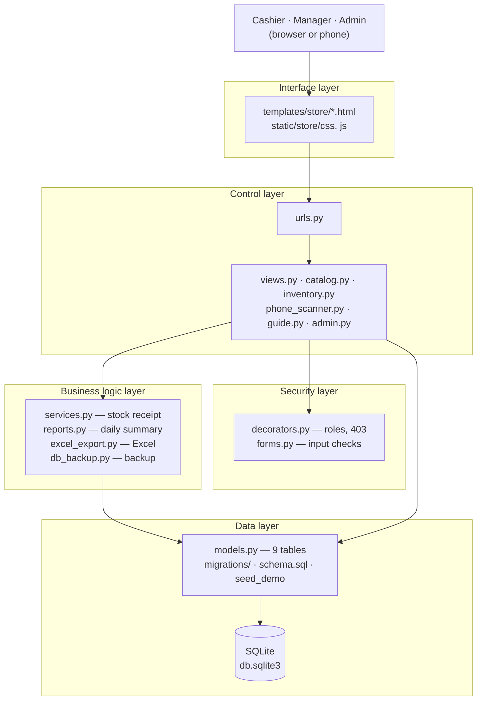
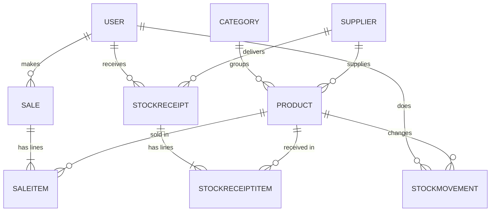
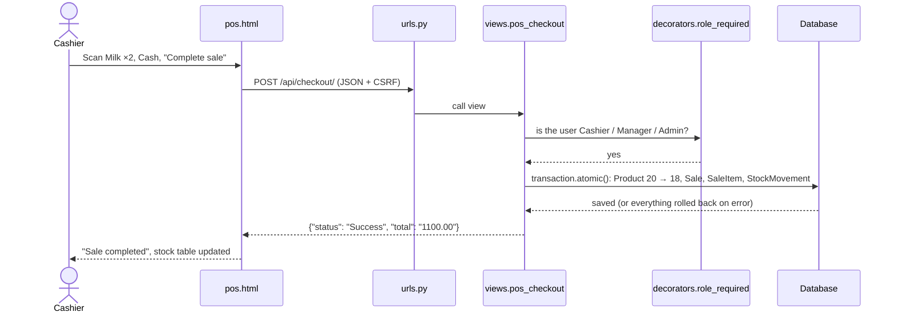

# Qoyma ERP — Code Decomposition

Owner of this document: Aizada Amanova (Systems Analysis & Requirements Lead)

Qoyma is one Django project (`qoyma/`) with one application (`store/`).
The code is split in two ways: **by layer** (what kind of work the code does)
and **by module** (what the user gets).

## 1. Decomposition by layer

| # | Layer | Files | What it does |
|---|-------|-------|--------------|
| 1 | Settings | `qoyma/settings.py`, `qoyma/urls.py`, `manage.py`, `.env` | Database, time zone, secret key, main URLs |
| 2 | Data | `store/models.py`, `store/migrations/`, `schema.sql`, `seed_demo.py` | 9 tables and their rules; demo data |
| 3 | Business logic | `services.py`, `reports.py`, `excel_export.py`, `db_backup.py` | Stock receipt, report numbers, Excel file, backup |
| 4 | Control (views) | `views.py`, `catalog.py`, `inventory.py`, `phone_scanner.py`, `guide.py`, `admin.py`, `urls.py` | Takes a request, calls the logic, returns a page or JSON |
| 5 | Security | `decorators.py`, `forms.py` | Role check (403), login redirect, form validation |
| 6 | Interface | `templates/store/*.html` (14 pages), `static/store/` | POS, receive stock, products, report, help, login |
| 7 | Tests | `store/test_*.py`, `qa/test_browser.py` | Unit, integration, acceptance, stress and browser tests |
| 8 | Documentation | `README.md`, `docs/`, `qa/` | User guide, UAT, criteria, QA reports |

## 2. Data model (9 tables)

| Group | Tables |
|-------|--------|
| Master data | User, Category, Supplier, Product |
| Incoming goods | StockReceipt, StockReceiptItem |
| Sales | Sale, SaleItem |
| History (audit) | StockMovement — every stock change: who, when, before → after, reason |

## 3. Decomposition by module

| Module | What the user gets | Code | Tests | Owner (role) |
|--------|--------------------|------|-------|--------------|
| Login and roles | Log in / out; Cashier, Manager, Admin; 403 for wrong role | `decorators.py`, `login.html` | `test_unit.py`, `tests.py` (AC-03, AC-04) | Architecture & Security |
| POS (sales) | Sell by barcode, choose Cash / Kaspi QR / Card | `views.pos_checkout`, `pos.html` | `tests.py` (AC-01, AC-02), `test_qa.py` | Application & Development |
| Stock receipt | Goods from a supplier increase stock | `services.receive_stock`, `receive.html`, `admin.py` | `tests.py` (AC-R1–AC-R4), `test_receipt_integration.py` | Requirements; Application & Development |
| Phone scanner | Scan barcodes with the phone camera | `phone_scanner.py`, `phone_scanner.html` | `test_phone_scanner.py` | Application & Development |
| Product catalog | Search, add, edit, delete products | `catalog.py`, `products.html`, `forms.py` | `test_catalog.py` | Testing & Integration |
| Data quality | Wrong data is never saved | `models.Product` | `tests.py` (V-01–V-05), `test_unit.py` | Requirements |
| Inventory adjustment and audit | Write-off with a reason; history of every stock change | `inventory.py`, `models.StockMovement`, `inventory_audit.html` | `test_inventory.py`, `test_audit.py` | Testing & Integration |
| Daily sales report | Dashboard for any day, Excel with charts, CSV, Admin link | `reports.py`, `excel_export.py`, `report.html` | `test_daily_report.py`, `test_report_*.py` | Requirements |
| Help | User guide inside the system | `guide.py`, `help.html` | `test_help_page.py` | Requirements |
| Backup | Copy and restore the database safely | `db_backup.py`, `backup_db`, `restore_db` | `test_backup.py` | Data & Database |
| Quality and load | System stays correct under many requests | whole system | `test_stress.py`, `test_regression.py`, `qa/test_browser.py` | Testing & Integration |

## 4. How one request flows (example: a sale)

## 5. Rules that hold across all modules

- **Atomic changes:** sales, receipts and adjustments save everything or nothing (`transaction.atomic()`).
- **One place for each rule:** product rules live in `models.Product`; role rules in `decorators.py`.
- **Every stock change leaves a trace** in `StockMovement`.
- **Every module has its own tests**; the whole suite runs with `python manage.py test store`.
