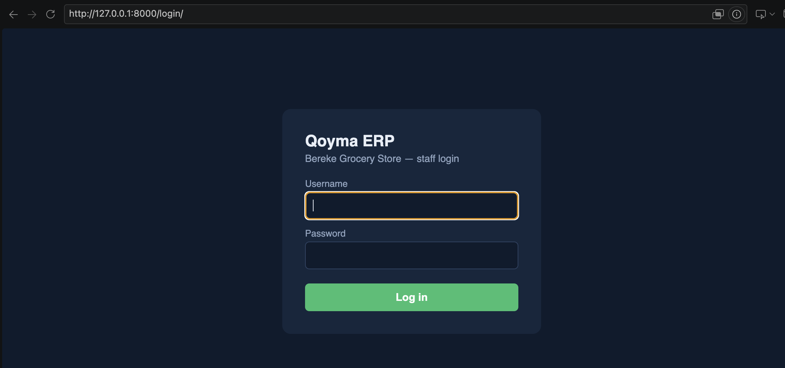
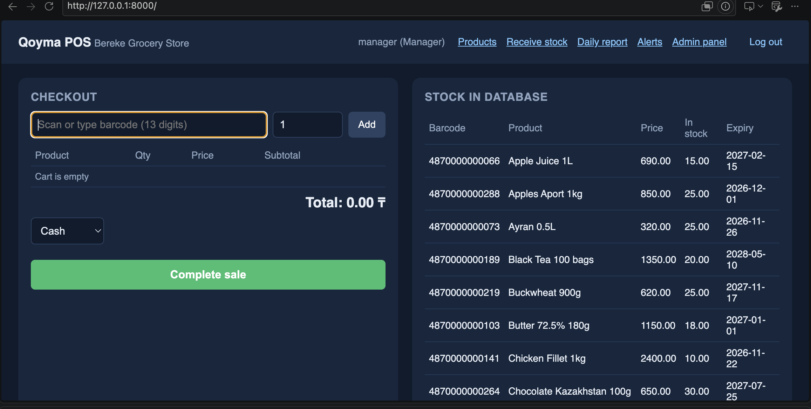
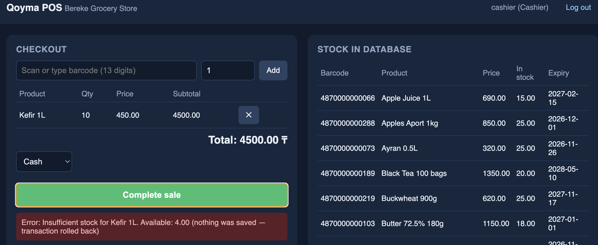
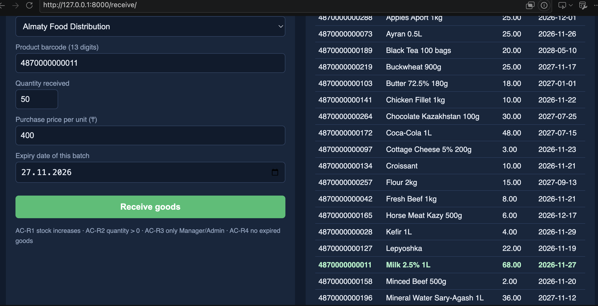
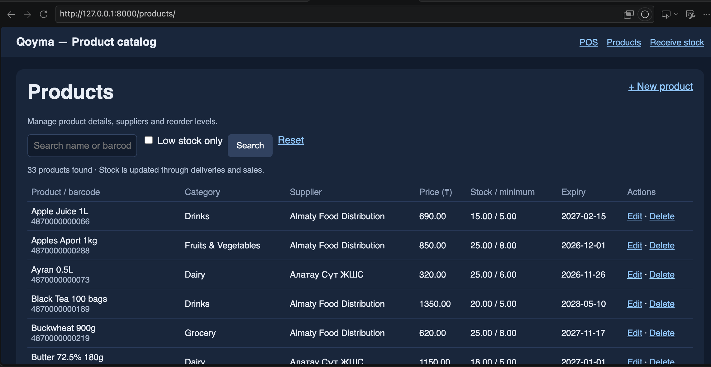
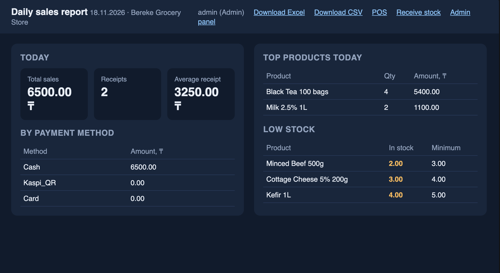
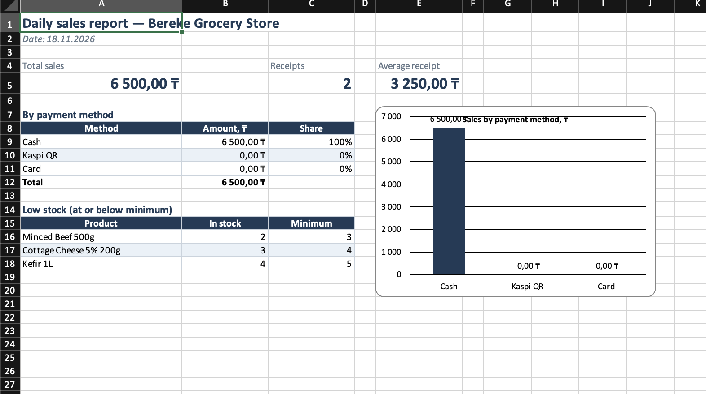
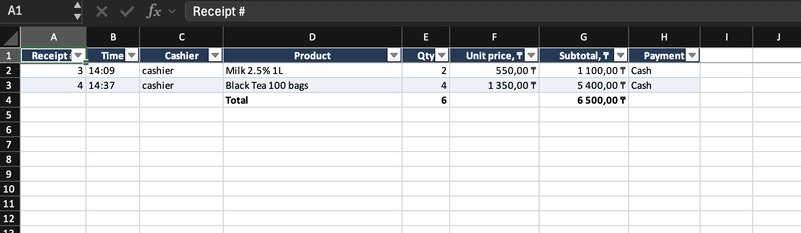
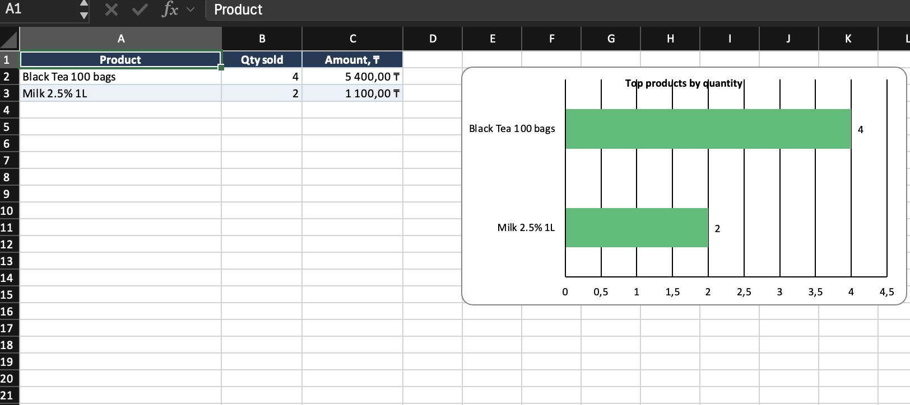

# Qoyma ERP — User Guide

For the staff of Bereke Grocery Store. Author: Aizada Amanova

## 1. Log in

Open the system and enter your username and password.

| Role | What you can do |
|------|-----------------|
| Cashier | Sell products |
| Manager | Sell, receive goods, manage products, view the daily report |
| Admin | Everything, including the Admin panel |

## 2. Cashier: sell products

1. Scan the barcode or type it (13 digits) in the barcode field.
2. Enter the quantity and press **Add** (or Enter).
3. Repeat for every product. To remove a line, press **✕**.
4. Choose the payment method: **Cash**, **Kaspi QR** or **Card**.
5. Press **Complete sale**. Stock decreases automatically.

If something is wrong, the system shows a red message and **nothing is saved**:

| Message | What to do |
|---------|-----------|
| Insufficient stock | Sell a smaller quantity or tell the manager |
| Product not found | Check the barcode or tell the manager |

## 3. Manager: receive goods from a supplier

1. Press **Receive stock** at the top.
2. Choose the supplier and scan the product barcode.
3. Enter the quantity, purchase price and expiry date of the batch.
4. Press **Receive goods**. Stock increases and the product row turns green.

The system refuses: quantity 0 or less, goods that are already expired, an unknown barcode.

## 4. Manager: products

- **Products** — list of all products; search by name or barcode, tick **Low stock only** to see what to order.
- **+ New product** — add a product. Price must be greater than 0, barcode must be 13 digits.
- **Edit / Delete** — change or remove a product.

## 5. Manager: daily sales report

Press **Daily report**. You see for today:

- total sales, number of receipts and average receipt;
- amounts by payment method;
- top 5 products;
- products at or below the minimum stock — order them.

### Download Excel

Press **Download Excel** to get a ready report file `sales_YYYY-MM-DD.xlsx` with three sheets.

**Summary** — key numbers, payment methods with a chart, low stock:

**Sales** — every sold item with filters and a total row:

**Top products** — best sellers with a chart:

**Download CSV** gives raw data for other programs (for Excel, use **Download Excel**).

## 6. Log out

Press **Log out** at the top right when you finish your shift.

## Demo accounts

| Role | Login | Password |
|------|-------|----------|
| Cashier | cashier | QoymaCashier2026 |
| Manager | manager | QoymaManager2026 |
| Admin | admin | QoymaAdmin2026 |
